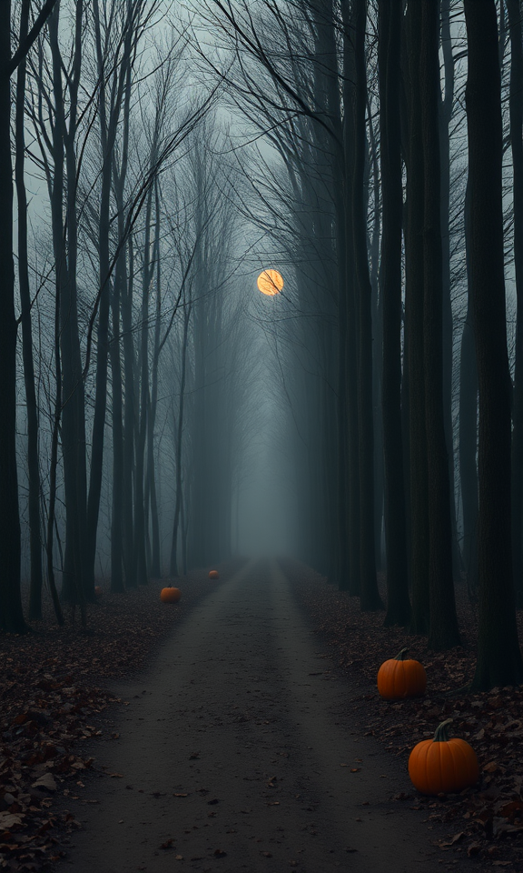
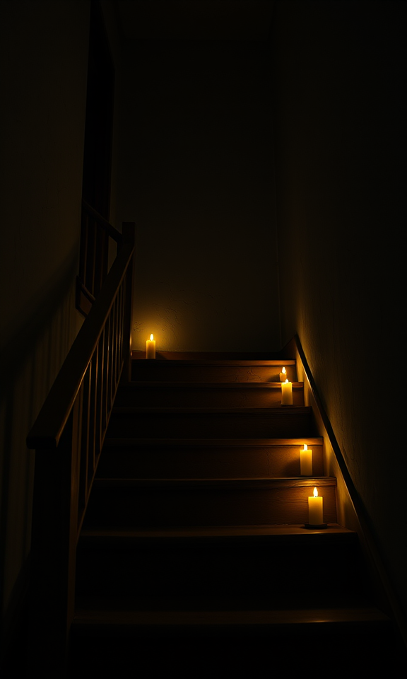
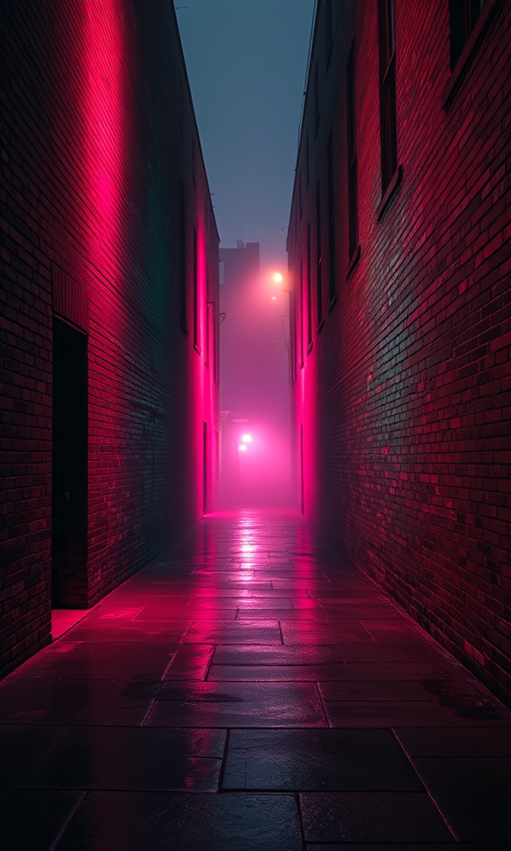
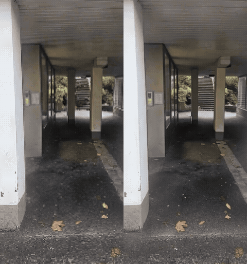

# ComfyUI-CameraThief

Forest, a candlelit staircase, and a rainy alley. Each one is a push-in stolen from a phone clip.

Left is the photograph reprojected along the stolen path. Right is the finished video.

**Live demo:** https://camera-thief.vercel.app

[Demo reel](docs/camera_thief_reel.mp4)

Steal the camera move from a short phone clip and apply that move to a still photograph.

Depth Anything 3 reads the camera path from the clip and the depth of the photograph. The photograph is re-projected along that path into a depth and edge guide. LTX-2.3, with the union-control IC-LoRA, renders a new video that follows the stolen move.

Any phone clip becomes a reusable camera move. The models are open weights. It runs in ComfyUI on your own machine. There is no closed API.

The nodes in this repo are MIT. The model weights are not included. Each weight file keeps its own license, listed below.

## Run the example

The example is an underpass push-in. The graph, the prompt, the seed, and the sampler are already filled in: 576×960, 81 frames, 24 fps.

This example was run on a 48GB GPU. The video model is a 22-billion-parameter checkpoint in fp8.

1. Install [ComfyUI](https://github.com/comfyanonymous/ComfyUI) 0.43 or newer.
2. Clone this repo into `ComfyUI/custom_nodes/ComfyUI-CameraThief`.
3. Clone [ComfyUI-LTXVideo](https://github.com/Lightricks/ComfyUI-LTXVideo) into `ComfyUI/custom_nodes` and check out commit `220e1d45aa0469f518e982102fca4dca92a61862`. Those nodes run the LTX part of the graph. Depth Anything 3 is built into ComfyUI 0.43.
4. Download the five model files in the table below. Put each file in the folder named there. The weights stay on your machine. They are not part of this repo.
5. Copy this repo's `example` folder to `ComfyUI/input/example`. The graph refers to `example/vent.mp4` and `example/underpass.png`, relative to ComfyUI's input folder.
6. Restart ComfyUI.
7. Drop `workflows/camera_thief_ui.json` on the ComfyUI window. That is the arranged graph. `workflows/camera_thief.json` is the same graph in API form, with the same settings.
8. Queue the prompt.

ComfyUI writes two videos to the output folder:

- `stolen_guide_00001_.mp4` is the photograph re-projected along the stolen path.
- `camera_thief_00001_.mp4` is the finished video.

On this underpass still, the guide has an empty strip on the right. The demo reel crops 128 pixels off that edge of the guide and the finished video together, so the two stay aligned.

No extra Python packages are required for this node pack.

## Models

Download these five files. They are not in this repo.

| File | Put it in | License | Download |
| --- | --- | --- | --- |
| `depth_anything_3_base.safetensors` | `models/geometry_estimation` | Apache-2.0. Camera path. Base has the camera decoder. | [file](https://huggingface.co/Comfy-Org/Depth-Anything-3/resolve/main/geometry_estimation/depth_anything_3_base.safetensors) · [card](https://huggingface.co/depth-anything/DA3-BASE) |
| `depth_anything_3_metric_large.safetensors` | `models/geometry_estimation` | Apache-2.0. Depth of the still, in metres. | [file](https://huggingface.co/Comfy-Org/Depth-Anything-3/resolve/main/geometry_estimation/depth_anything_3_metric_large.safetensors) · [card](https://huggingface.co/depth-anything/DA3METRIC-LARGE) |
| `ltx-2.3-22b-distilled-fp8.safetensors` | `models/checkpoints` | [LTX-2 Community License](https://github.com/Lightricks/LTX-2/blob/main/LICENSE-2). The video model. Free under $10 million annual revenue. | [file](https://huggingface.co/Lightricks/LTX-2.3-fp8/resolve/main/ltx-2.3-22b-distilled-fp8.safetensors) |
| `gemma_3_12B_it_fp4_mixed.safetensors` | `models/text_encoders` | [Gemma Terms of Use](https://ai.google.dev/gemma/terms). The text encoder LTX needs. Open weights. | [file](https://huggingface.co/Comfy-Org/ltx-2/resolve/main/split_files/text_encoders/gemma_3_12B_it_fp4_mixed.safetensors) · [card](https://huggingface.co/google/gemma-3-12b-it) |
| `ltx-2.3-22b-ic-lora-union-control-ref0.5.safetensors` | `models/loras` | [LTX-2 Community License](https://github.com/Lightricks/LTX-2/blob/main/LICENSE-2). Depth and edge control. | [file](https://huggingface.co/Lightricks/LTX-2.3-22b-IC-LoRA-Union-Control/resolve/main/ltx-2.3-22b-ic-lora-union-control-ref0.5.safetensors) |

DA3-Large and DA3-Giant are different checkpoints, and they are non-commercial. This workflow does not use them.

## Wire

1. Load the clip. Run **Depth Anything 3** on those frames with the **Base** model, mode **multiview**.
2. Connect that result to **Steal Camera Move**. Use **Save Camera Move** if you want a `.cammove` file.
3. Load the still. Run **Depth Anything 3** on it with the **Metric-Large** model, mode **mono**.
4. Optional: **Retarget Camera Move**. Strength `1` keeps the stolen move, `0` locks the camera, `2` exaggerates it. Speed `2` finishes the move halfway and holds. Mirror swaps left and right.
5. Connect the still, the mono depth, and the move to **Apply Move to Image**.
6. Feed the still in as the LTX first frame and the depth output as the LTX union-control guide. Keep the guide the same frame count as the video. The frame count is `8n+1` (9, 17, 25, …).

The hole mask is white where the guide has no surface. The depth image is white where the surface is near.

## `.cammove`

A small JSON file. Poses are OpenCV world-to-camera matrices, and the first pose is the identity. `fov_deg` is one horizontal field of view per pose, so a zoom in the source clip is kept. `depth_scale` is the clip's median depth in the same units as the pose translation. Apply scales that translation onto the still's depth, so a dolly stays in proportion with the zoom.

## Credits

- Depth Anything 3
- LTX-2.3 and the union-control IC-LoRA
- Gemma 3
- ComfyUI
- [FLUX.1 schnell](https://huggingface.co/black-forest-labs/FLUX.1-schnell) (Apache-2.0, demo stills only, generated separately, not part of the workflow)
- Vercel and Comfy Cloud, for hosting

The Camera Thief workflow itself is open weights only.

